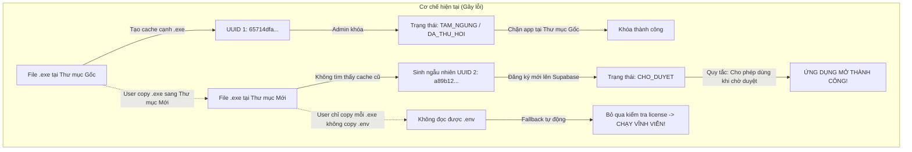
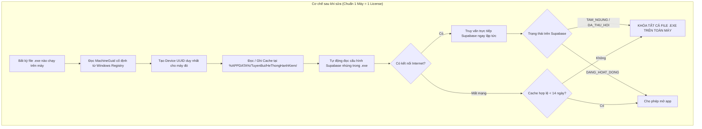

# BÁO CÁO KỸ THUẬT: PHÂN TÍCH LỖI BYPASS BẢN QUYỀN VÀ PHƯƠNG ÁN KHẮC PHỤC
**Hệ thống:** Tổng hợp Hạnh kiểm / Rèn luyện — Phân hệ Quản trị Quyền sử dụng từ xa (Supabase)  
**Thời gian lập:** 18/10/2026  
**Người phát hiện:** Quản trị viên hệ thống  
**Mức độ nghiêm trọng:** 🔴 **Cao (High Security Risk)** — Người dùng có thể vô hiệu hóa trạng thái Tạm ngưng/Thu hồi bằng thao tác sao chép file thông thường.

---

## 1. Tóm tắt vấn đề (Executive Summary)

Khi Quản trị viên đặt trạng thái thiết bị thành **`TAM_NGUNG` (Tạm ngưng)** hoặc **`DA_THU_HOI` (Thu hồi)** trên bảng điều khiển Quản trị:
- Thiết bị chạy tại thư mục cài đặt ban đầu bị khóa theo đúng thiết kế.
- **Tuy nhiên**, nếu người dùng sao chép file `.exe` sang bất kỳ thư mục nào khác (ví dụ: màn hình Desktop, ổ đĩa khác, thư mục Downloads), ứng dụng **tiếp tục hoạt động bình thường** và hoàn toàn bỏ qua trạng thái khóa của Quản trị viên.

---

## 2. Kết quả kiểm thử và tái hiện lỗi (Proof of Concept)

Quá trình kiểm thử thực tế trên hệ thống đã xác nhận hiện tượng:



---

## 3. Phân tích nguyên nhân gốc rễ (Root Cause Analysis)

Lỗi bắt nguồn từ 3 sơ hở logic liên hoàn trong mã nguồn:

### 3.1. Sơ hở 1: Lưu cache license cục bộ theo thư mục (`Per-Directory`) thay vì theo hệ thống (`Per-Machine`)
* **Vị trí mã:** [app/license_client.py:42-52](file:///d:/OneDrive%20-%20T%E1%BA%ACP%20%C4%90O%C3%80N%20GI%C3%81O%20D%E1%BB%A4C%20IGC/Desktop/V2.19/app/license_client.py#L42-L52)
* **Hiện trạng:**
  ```python
  def _get_config_dir() -> Path:
      if getattr(os.sys, 'frozen', False):
          return Path(os.sys.executable).parent  # Lưu file .license_cache.json ngay cạnh file .exe
      return Path(__file__).resolve().parent.parent
  ```
* **Hậu quả:** File bản quyền `.license_cache.json` chỉ có giá trị trong đúng thư mục chứa nó. Khi copy `.exe` sang thư mục mới, app không thấy file cache nên bắt đầu chu trình cấp phép từ số 0.

### 3.2. Sơ hở 2: Mã định danh thiết bị (UUID) sinh ngẫu nhiên thay vì gắn với máy tính
* **Vị trí mã:** [app/license_client.py:265-267](file:///d:/OneDrive%20-%20T%E1%BA%ACP%20%C4%90O%C3%80N%20GI%C3%81O%20D%E1%BB%A4C%20IGC/Desktop/V2.19/app/license_client.py#L265-L267)
* **Hiện trạng:**
  ```python
  def generate_device_uuid() -> str:
      return str(uuid.uuid4())  # Tạo UUID ngẫu nhiên hoàn toàn
  ```
* **Hậu quả:** Mỗi khi đăng ký lại ở thư mục mới, app sinh ra một UUID hoàn toàn mới (ví dụ `a89b...` thay vì `6571...`). Quản trị viên chỉ khóa UUID cũ trên Dashboard, còn UUID mới chưa bị khóa. Hơn nữa, trạng thái ban đầu của UUID mới là `CHO_DUYET` (Chờ duyệt), mà code lại cho phép thiết bị `CHO_DUYET` được dùng tự do.

### 3.3. Sơ hở 3: Bỏ qua kiểm tra bản quyền nếu thiếu file `.env`
* **Vị trí mã:** [app/license_ui.py:497-501](file:///d:/OneDrive%20-%20T%E1%BA%ACP%20%C4%90O%C3%80N%20GI%C3%81O%20D%E1%BB%A4C%20IGC/Desktop/V2.19/app/license_ui.py#L497-L501) và [app/license_client.py:410-416](file:///d:/OneDrive%20-%20T%E1%BA%ACP%20%C4%90O%C3%80N%20GI%C3%81O%20D%E1%BB%A4C%20IGC/Desktop/V2.19/app/license_client.py#L410-L416)
* **Hiện trạng:**
  ```python
  supa_url, anon_key = get_supabase_config()
  if not supa_url or not anon_key:
      # Chưa cấu hình Supabase -> cho phép chạy (graceful fallback)
      return True
  ```
* **Hậu quả:** Khi người dùng chỉ copy mỗi file `HeThong_HanhKiem_RenLuyen_TuyenBui.exe` ra nơi khác mà không copy kèm file `.env`, app không đọc được URL Supabase và tự động cho qua (bypass 100%).

### 3.4. Sơ hở 4: Cơ chế Cache 24 giờ không kiểm tra lại ngay khi mở app
* **Vị trí mã:** [app/license_client.py:231-240](file:///d:/OneDrive%20-%20T%E1%BA%ACP%20%C4%90O%C3%80N%20GI%C3%81O%20D%E1%BB%A4C%20IGC/Desktop/V2.19/app/license_client.py#L231-L240)
* **Hiện trạng:**
  ```python
  def needs_online_check(self) -> bool:
      return datetime.now() - last_check >= timedelta(hours=24)
  ```
* **Hậu quả:** Nếu máy tính đã kết nối thành công cách đó ít giờ, app sẽ tin tưởng file cache cũ trong 24 giờ mà không gửi truy vấn lên Supabase để kiểm tra xem Quản trị viên vừa bấm Tạm ngưng hay chưa.

---

## 4. Phương án khắc phục toàn diện (Fix Bug Solution)



### Chi tiết các bước điều chỉnh kỹ thuật:

| STT | Hạng mục | Giải pháp kỹ thuật cụ thể |
|:---:|---|---|
| **1** | **Cố định mã thiết bị theo Windows MachineGuid** | Thay hàm `uuid.uuid4()` bằng hàm đọc `HKEY_LOCAL_MACHINE\SOFTWARE\Microsoft\Cryptography\MachineGuid`. Đây là GUID hệ điều hành Windows cấp cho máy, hoàn toàn ẩn danh (không lấy MAC, GPS, Wi-Fi), không thay đổi dù di chuyển file sang thư mục nào. |
| **2** | **Chuyển cache sang `%APPDATA%`** | Đổi đường dẫn lưu cache thành: `Path(os.environ["APPDATA"]) / "TuyenBui" / "HeThongHanhKiem" / ".license_cache.json"`. Mọi bản copy của file `.exe` trên máy đều dùng chung duy nhất một tệp quản lý này. |
| **3** | **Nhúng cấu hình Supabase vào mã nguồn** | Đọc cấu hình từ `sys._MEIPASS` (thư mục giải nén của PyInstaller) và thiết lập fallback URL + Anon Key cố định trong mã. Bỏ hoàn toàn logic `return True` khi thiếu `.env`. |
| **4** | **Kiểm tra Online tức thời khi mở ứng dụng** | Khi khởi động app: Nếu máy có kết nối mạng, luôn gửi yêu cầu xác thực trạng thái mới nhất từ Supabase (bỏ độ trễ 24h). Chỉ dùng cache khi thực sự mất mạng (cho phép tối đa 14 ngày). |
| **5** | **Kiểm tra bản quyền trước khi bấm "TỔNG HỢP"** | Bổ sung hàm kiểm tra bản quyền nhanh ngay khi người dùng nhấn nút **TỔNG HỢP** trong [app/main.py](file:///d:/OneDrive%20-%20T%E1%BA%ACP%20%C4%90O%C3%80N%20GI%C3%81O%20D%E1%BB%A4C%20IGC/Desktop/V2.19/app/main.py), chặn việc xuất dữ liệu nếu thiết bị đang bị ngưng. |
| **6** | **Chặt chẽ trạng thái `CHO_DUYET`** | Thiết bị mới đăng ký chỉ được cấp quyền dùng thử ngắn hạn có kiểm soát hoặc phải chờ Quản trị viên duyệt mới được vào giao diện chính. |

---

## 5. Kế hoạch triển khai

1. **Bước 1:** Cập nhật logic trong [app/license_client.py](file:///d:/OneDrive%20-%20T%E1%BA%ACP%20%C4%90O%C3%80N%20GI%C3%81O%20D%E1%BB%A4C%20IGC/Desktop/V2.19/app/license_client.py) (MachineGuid, đường dẫn APPDATA, kiểm tra online).
2. **Bước 2:** Cập nhật [app/license_ui.py](file:///d:/OneDrive%20-%20T%E1%BA%ACP%20%C4%90O%C3%80N%20GI%C3%81O%20D%E1%BB%A4C%20IGC/Desktop/V2.19/app/license_ui.py) và chốt chặn tại nút "TỔNG HỢP" trong [app/main.py](file:///d:/OneDrive%20-%20T%E1%BA%ACP%20%C4%90O%C3%80N%20GI%C3%81O%20D%E1%BB%A4C%20IGC/Desktop/V2.19/app/main.py).
3. **Bước 3:** Chạy bộ kiểm thử tự động [tests/test_license.py](file:///d:/OneDrive%20-%20T%E1%BA%ACP%20%C4%90O%C3%80N%20GI%C3%81O%20D%E1%BB%A4C%20IGC/Desktop/V2.19/tests/test_license.py) để xác nhận 100% kịch bản đạt yêu cầu.
4. **Bước 4:** Đóng gói lại file thực thi `.exe` với PyInstaller.
